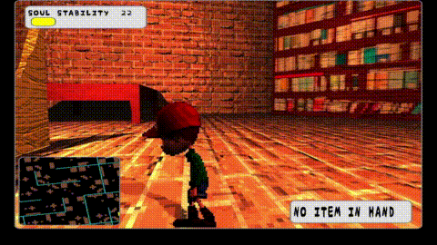
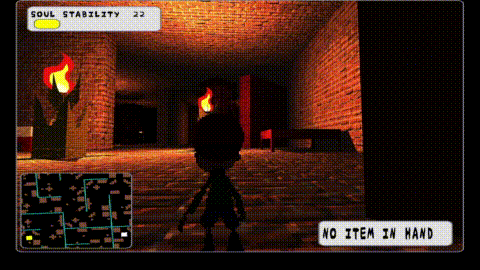
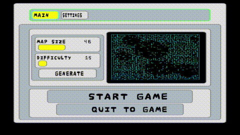
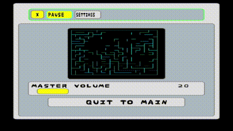
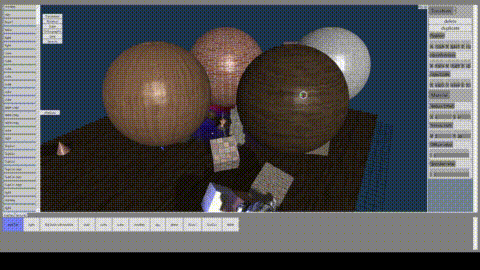
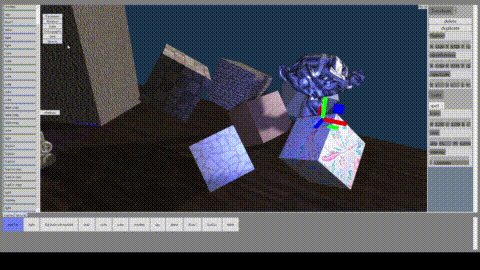
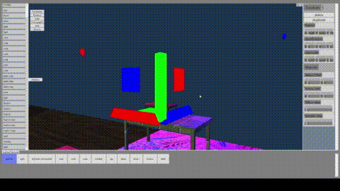
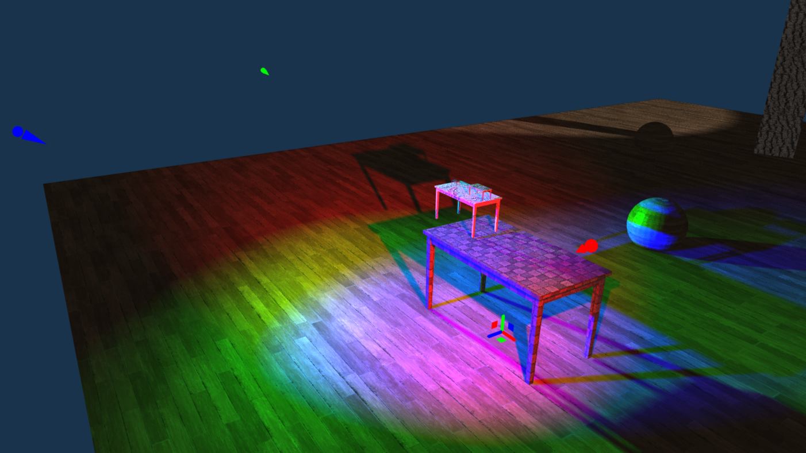
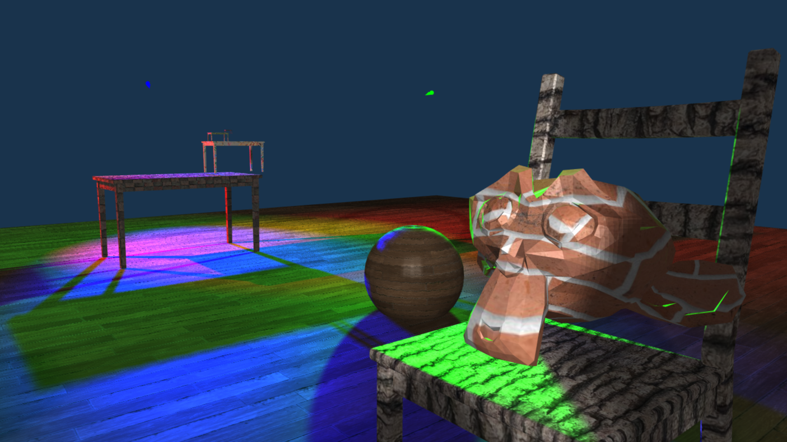
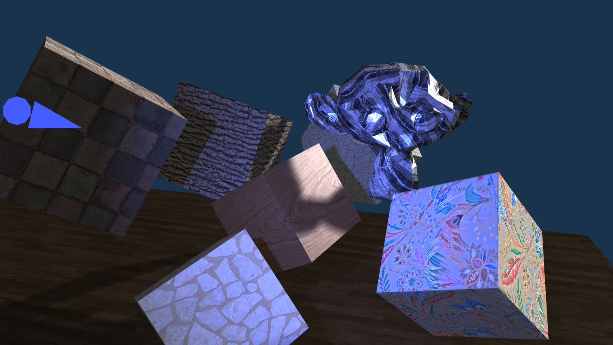

# Hi, I'm Glory

### Computer Science & Mathematics Student | Graphics Programming | Software Development

I'm a second-year Computer Science and Mathematics student at the **University of Manchester**, interested in understanding how software works under the hood and building things from the ground up.

I particularly enjoy computer graphics, low-level programming, and exploring the intersection between mathematics and computer science.

---

### Interests

- **Computer Graphics:** Real-time rendering, OpenGL, shaders, and graphics pipelines.
- **Systems Programming:** C++, memory management, and operating systems.
- **Virtual Reality:** Immersive applications and interactive technologies.
- **Open Source:** Contributing to projects and collaborating with other developers.

---

## Featured Projects
<table width="100%">
        <tr>
          <td align="center"></td>
          <td align="center"></td>
          <td align="center"></td>
          <td align="center"></td>
        </tr>
</table>
<table width="100%">
  <tr>
    <td width="30%" valign="top">
      <h3>Maze of Lost Souls</h3>
      
A graphics and systems project exploring rendering techniques, custom shaders, and immersive gameplay mechanics.

  * **Languages:** `C++`
  * **Graphics & Development:** `OpenGL`, `GLSL`, `GLFW`, `GLM`
  * **Tools & Platforms:** `Git`, `CMake`, `Visual Studio`, `Windows`
    </td>
    <td width="70%" valign="top">
          
          
          
    </td>
</table>

---
<table width="100%">
        <tr>
          <td align="center"></td>
          <td align="center"></td>
          <td align="center"></td>
        </tr>
</table>
<table width="100%">
  <tr>
    <td width="30%" valign="top">
      <h3>Not Blender</h3>
      
A custom 3D modeling and rendering tool built from scratch to understand 3D pipelines and viewport manipulation.

  * **Languages:** `C#`, `XML`
  * **Graphics & Development:** `OpenGL`, `GLSL`, `OpenTK`, `WPF`
  * **Tools & Platforms:** `Git`, `Visual Studio`, `Windows`
    </td>
    <td width="70%" valign="top">
          
          
          
      
    </td>
  </tr>
</table>
---

### What I'm Working On

- Exploring real-time rendering and advanced graphics programming.
- Developing high-performance projects using C++ and OpenGL.
- Experimenting with VR and interactive applications.
- Getting involved in open-source software development.

---

<em>Always learning, building, and experimenting.</em>

